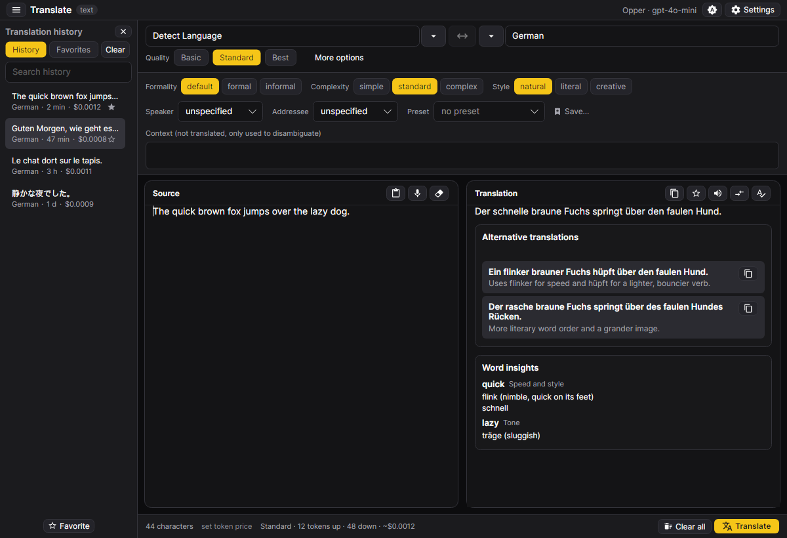

# Hakata

**A desktop text translator that runs on your own provider - any OpenAI-compatible API, your key, your bill.**



Your text on the left, the translation on the right. No account, no subscription and no middleman: bring the key you already have for whichever model you prefer, hosted or on your own machine, and the app talks to that provider only.

## Features

Everything a translator needs, plus the parts most of them leave out.

- **385 languages** - searchable pickers, *Detect Language* as the source, a swap button, most used first.
- **Model routing and options** - a model and reasoning effort per tier, plus formality, style, gender and context.
- **Several providers side by side** - every slot picks `provider · model`, so a cheap model can sit next to an expensive one.
- **Alternatives and word insights** - other ways to say it, as many as you set, each with a reason, plus nuance variants for the words you are unsure about.
- **Presets** - name a wording setup and recall it with Ctrl+1…9.
- **History** - every translation, searchable and filterable, with starring and deletion for several rows at once.
- **Know the cost** - tokens in and out, a price field and a running total; published prices fill themselves in.
- **Voice input and read-aloud** - dictate instead of typing, or have the finished text read back to you.
- **Transliteration** - a Latin-letter line under Cyrillic, Arabic, CJK, Korean and other non-Latin scripts.

## Requirements

- **An OpenAI-compatible endpoint** - Opper or OpenRouter, the two this build is tested against, or any other `/chat/completions` server you point it at.
- **Windows 10 or newer** for the prebuilt download. Linux has its own build; macOS runs from source.
- **Windows or Linux for speech.** On Linux the app reaches PulseAudio and PipeWire through ALSA and needs `libasound2` and `libsndfile1` installed; on macOS it runs, but speech reports itself unavailable.

## Installation

### Windows

1. Download the latest [release](https://github.com/regularentropy/hakata/releases/latest) and unzip it anywhere.
2. Run `hakata.exe`. Self-contained: no .NET installation, no installer, no admin rights.

### From source

```bash
git clone https://github.com/regularentropy/hakata.git
cd hakata
dotnet run --project src/hakata
```

## Providers

Anything that speaks `/chat/completions` works. These two are the ones Hakata is actually tested against:

| provider | base URL | model |
| --- | --- | --- |
| Opper | `https://api.opper.ai/v3/compat` | `melious/glm-5.3-flash`, `melious/deepseek-v4.1-flash` |
| OpenRouter | `https://openrouter.ai/api/v1` | `google/gemini-3.8-flash` |

Each provider takes a name, URL, key and default model. An empty slot falls back to the first provider, and the grey hint in the field names the one it will use.

## Quick start

1. Open **Settings** with <kbd>Ctrl</kbd>+<kbd>,</kbd> and fill in a base URL, an API key and a model - or point it at a local server and leave the key empty.
2. Choose the language pair, or leave the source on *Detect Language*.
3. Type, paste or drop a text and press **Translate**.

That is the whole setup. Everything else, from tiers to prices, is optional.

## Your data stays yours

- **Local by default.** Settings, history and cached audio live in `%AppData%\hakata\profiles\default\` on Windows and `~/.config/hakata/profiles/default/` on Linux; `HAKATA_HOME` moves them. Besides your provider, the only request is the GitHub update check, on by default and one toggle away in Settings → About.
- **History is encrypted at rest.** On Windows a key bound to your account (DPAPI) unlocks it, so a copied history file is unreadable without it; elsewhere the key is a file only your user can read. Settings → Display can wrap it in a password, which is also how you move the folder to another machine.
- **Keys and cached audio are encrypted the same way.** An audio file is named after a keyed hash of its text, so it reveals nothing about what was said.
- **What it does not protect against:** something already running as you, on an unlocked machine. Full-disk encryption is the tool for that.

## Profiles

A profile is its own data folder: history, settings and keys. Settings → Profiles creates, renames and deletes them; **Switch** loads one in the current window without a restart, *Open in new instance* runs a second one next to it, and *Set as default* decides what a plain launch opens.

Hakata runs one instance per profile. A second launch brings the running window forward on Windows; elsewhere an exclusive lock keeps it to one.

## Keyboard shortcuts

| Shortcut | Action |
| --- | --- |
| <kbd>Ctrl</kbd>+<kbd>Enter</kbd> | Translate, from anywhere |
| <kbd>Ctrl</kbd>+<kbd>K</kbd> | Focus the source box |
| <kbd>Ctrl</kbd>+<kbd>N</kbd> | New translation |
| <kbd>Ctrl</kbd>+<kbd>,</kbd> | Settings |
| <kbd>Ctrl</kbd>+<kbd>Shift</kbd>+<kbd>V</kbd> | Paste |
| <kbd>Ctrl</kbd>+<kbd>1</kbd>…<kbd>9</kbd> | Jump to preset 1–9 (numpad works too) |
| <kbd>Ctrl</kbd>+<kbd>P</kbd> | Next preset |
| <kbd>Esc</kbd> | Cancel the run, or drop a recording |

## Contributing

Issues and pull requests are welcome on [GitHub](https://github.com/regularentropy/hakata). For a translation that went wrong, include the provider, model, language pair and text. Before sending a pull request, run the harness: `dotnet run --project tests/Hakata.Tests -- --selftest`.

## License

[GPLv3](LICENSE) © 2026 [regularentropy](https://github.com/regularentropy) ([website](https://regularentropy.github.io/))

Third-party components keep their own licenses: Avalonia, CommunityToolkit.Mvvm, Material.Icons.Avalonia, Markdown.Avalonia, Microsoft.EntityFrameworkCore.Sqlite, Microsoft.Extensions.DependencyInjection and NAudio are MIT; SQLite itself is public domain.
